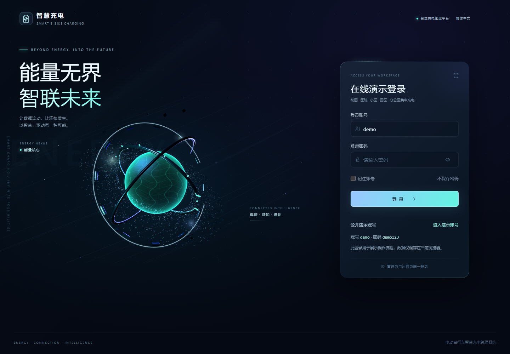
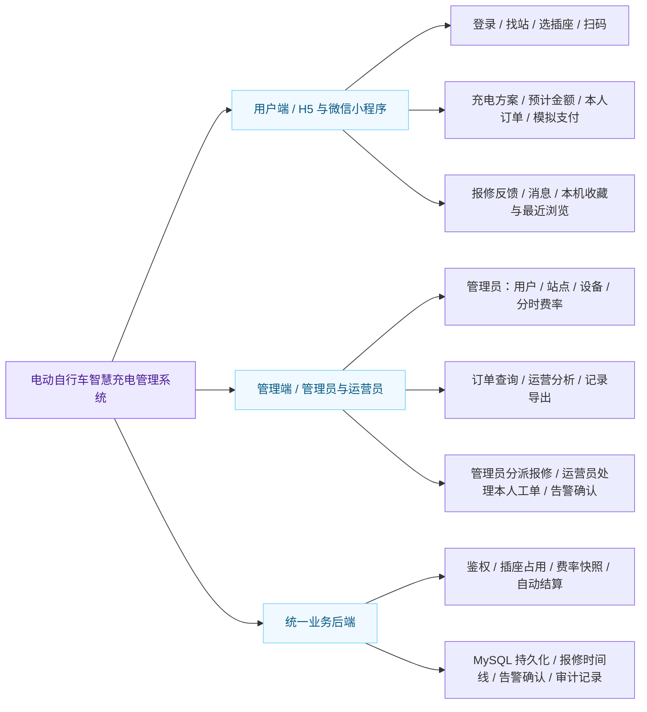
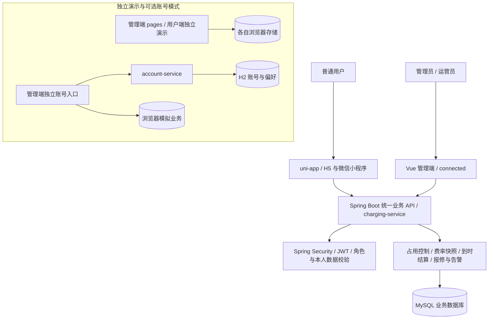
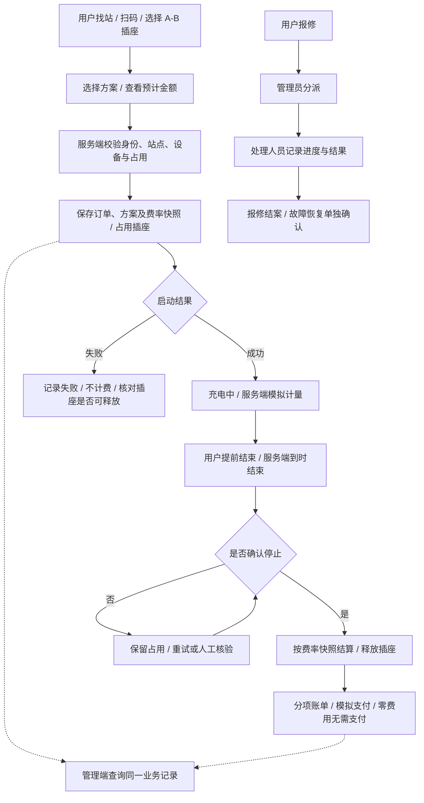
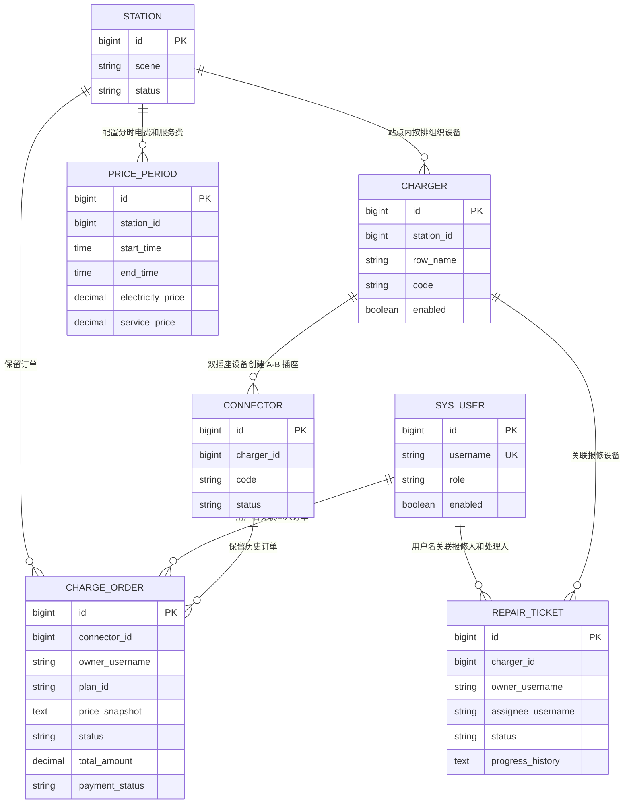

# 电动自行车智慧充电管理系统

**Smart E-Bike Charging Management System**

[](https://github.com/ifox-hu/campus-ebike-charging/actions/workflows/pages.yml)


面向**校园、住宅小区、医院、产业园区及企事业单位办公区**等具有电动自行车集中停放和充电需求的场所，**以校园作为重点应用与演示场景**。项目包含 **Vue 3 + Vite 管理端、Spring Boot 后端、uni-app 用户端**，站点按“**站点 → 多排设备 → 每台设备两个独立插座 A/B**”组织。

**[在线演示](https://ifox-hu.github.io/campus-ebike-charging/) · [部署说明](docs/deployment.md) · [问题反馈](https://github.com/ifox-hu/campus-ebike-charging/issues)**

> 在线页面是公开静态演示，演示账号 `demo`、密码 `demo123`（仅模拟登录流程，并非真实身份认证）；业务、资料、通知与设置只保存在访问者自己的浏览器，不控制真实充电设备，不发生真实付款。
>
> 本轮最终联机验收组合（2026-11-14）：本仓库 `frontend/` 的 connected 管理端、本仓库 `mobile-client/` 用户端，以及配套 `ev-charging-platform/backend/`。两端共用 `/api` 业务接口。新订单仅核算电费，历史账单不重算。详见 [验收矩阵](docs/graduation-acceptance.md)、[演示脚本](docs/graduation-demo.md) 与 [最终架构](docs/graduation-architecture.md)。
>
> 本仓库 `uni-app/` 与 `backend/charging-service/` 保留为另一套参考实现，不能把其中的硬件低功率检测、地图或消息能力直接计入本轮联机验收。Pages仍为独立静态演示。

## 目录

- [项目预览](#项目预览)
- [项目特点](#项目特点)
- [适用场景](#适用场景)
- [运行模式](#运行模式)
- [功能模块](#功能模块)
- [技术与架构](#技术与架构)
- [业务交互流程](#业务交互流程)
- [快速开始](#快速开始)
- [核心数据关系](#核心数据关系)
- [目录结构](#目录结构)
- [验证与当前边界](#验证与当前边界)
- [许可说明](#许可说明)

## 项目预览

### 管理端

演示账号：**`demo` / `demo123`**。支持填入演示账号、显示密码、记住账号及退出登录。

管理端与 Pages 共用能量核心登录界面：保留原版三维球体、机械轨道与粒子流，可拖拽旋转、滚轮或双指缩放、点击触发脉冲。三维资源随构建打包，登录后释放场景；不支持 WebGL 时显示静态视觉，仍可登录。

| 在线演示登录 | 运营数据统计与高德地图 |
| --- | --- |
|  |  |
| **设备排布与 A/B 插座** | **充电订单管理** |
|  |  |

### 用户端（H5 / 微信小程序）

配套用户端采用 uni-app，共用页面可构建为 H5 和微信小程序。以下是实际运行的 **H5 预览截图**，并非微信真机截图；当前联机用户端源码位于 `mobile-client/`；以下旧版截图对应保留的 `uni-app/` 参考实现。截图使用通用演示数据，不展示具体学校楼栋或坐标。截图来源与复现方式见 [展示说明](docs/showcase.md)。

| 找站与空闲筛选 | 设备排布与插座 |
| --- | --- |
|  |  |
| **五种充电方式与预计金额** | **充电中与模拟费用** |
|  |  |
| **结束结算与模拟支付** | **我的充电订单** |
|  |  |
| **故障报修** | **个人中心** |
|  |  |

## 项目特点

- **面向两轮充电**：围绕电动自行车站点与独立插座组织页面，避免混用汽车车牌、车型等信息。
- **按现场排布管理**：站点下配置多排设备，每台设备 A、B 两个插座独立选择与计费。
- **充电过程可追溯**：展示启动状态、计费快照、充电进度、分项账单与订单记录。
- **兼顾使用与管理**：配套用户端完成找站、充电和反馈，管理端处理资源维护、运营查看与异常。

## 适用场景

| 场景 | 典型站点位置 | 管理需求 |
| --- | --- | --- |
| 校园 | 学生公寓、食堂、教学区、体育场馆附近 | 师生找站、插座使用、充电计费与设备报修 |
| 住宅小区 | 非机动车停车棚、集中充电区、楼栋周边规划区域 | 居民充电、空闲插座查询、订单结算与物业维护 |
| 医院 | 职工停车棚、门诊配套非机动车停车区 | 职工及访客找站、充电计费、设备维护与报修 |
| 产业园区 | 园区员工停车棚、厂区配套非机动车停车区 | 通勤及换班充电、站点设备管理、运营统计 |
| 企事业单位办公区 | 办公楼配套停车棚、单位职工停车区 | 工作期间充电、空闲插座查询、费用与异常管理 |

各场景共用站点、设备排、A/B 插座、费率、订单和报修流程，通过站点场景分类与基础配置适配，无需为每类场所单独建立业务系统。校园作为论文重点应用与演示案例，医院、小区、产业园区和办公区样本用于补充验证通用流程；商业配套作为扩展场景。模拟点位不代表实际部署或实地调研结果，样本及数据升级方式见[多场景演示站点](docs/demo-scenarios.md)。

新增站点时选择“应用场景”，随后配置地址、坐标、设备排与费率。界面中的“办公区”对应本文的企事业单位办公区；旧“园区”分类继续保留，既有站点无需强制改名或迁移。场景分类用于找站与统计筛选，不改变充电、计费及权限规则。

## 运行模式

**查看完整业务流程时，推荐使用双端联网模式。** 两端访问同一业务后端，用户发起的订单、插座占用和报修可在管理端查询。

| 模式 | 入口 / 默认端口 | 数据保存位置 | 用途与边界 |
| --- | --- | --- | --- |
| 双端联网 | 管理端 `dev:connected` / 5201；用户端 `dev:connected` / 5198；业务 API / 8081 | MySQL 业务库；收藏、最近浏览和消息已读仍保存在本机 | 用户、管理员与运营员共用业务 API；用于完整联调 |
| 管理端静态演示 | `dev:pages` / 5207；或上方在线演示 | 当前浏览器 | 演示界面和本地业务规则，不连接统一业务后端 |
| 用户端独立演示 | `dev:h5` / 5197 | 当前浏览器 | 体验找站、充电和报修流程，不与独立管理演示共享订单 |
| 可选独立账号 | 管理端 `dev` / 5195；账号服务 / 8092 | H2 保存账号与偏好；充电业务保存在浏览器 | 验证管理员登录与资料功能，不代替统一业务后端 |

管理端、用户端的独立演示即使显示相似站点，也不代表两端已经共享业务数据。联网失败时应处理接口错误，不以本地演示结果替代成功响应。

## 功能模块

充电方案、扫码、运维功能及数据库升级步骤见 [充电方案与运营增强](docs/charging-operations.md)。下表以双端联网功能为主，独立演示和可选账号能力单独标明。

### 功能结构图



### 模块说明

| 模块 | 当前能力 | 运行模式 |
| --- | --- | --- |
| 账号与权限 | 普通用户注册登录及本人数据校验；管理员维护基础配置；运营员处理分派给自己的报修并确认告警 | 双端联网 |
| 站点与设备 | 场景分类、站点地图选点与地址回填、按排批量配置双插座设备、启停用及插座状态维护 | 双端联网；独立管理演示提供本地操作 |
| 用户找站与扫码 | 站点查询、设备排布、A/B 插座选择；H5 图片与摄像头识码、微信扫码入口 | 用户端；联网编号对应业务数据库 |
| 充电与计费 | 1h / 2h / 3h / 充满自停模拟 / 自定义方案、预计金额、分时费率快照、提前结束及服务端到时结算 | 双端联网；独立演示不具备页面关闭后的服务端任务 |
| 订单与模拟支付 | 本人订单筛选、管理端查询、分项费用；订单内记录模拟支付状态、方式、编号与时间 | 双端联网；演示模式使用本地记录 |
| 报修与告警 | 用户报修、管理员分派、运营员处理本人工单、处理时间线、告警确认及再次触发；结案与故障恢复分别维护 | 双端联网；独立演示仅演示本地流程 |
| 运营分析与导出 | 场景/日期筛选、已结束订单账单金额与电量、趋势、启动时段、当前站点占用率、订单和报修导出 | 联网管理端；独立演示另提供本地指标与图表 |
| 消息与个人使用记录 | 从本人订单、报修生成消息；收藏、最近浏览和消息已读按账号保存在本机 | 用户端；业务来源随模式区分 |
| 演示工作台 | 全局搜索、通知、字号与密度、资料设置及头像 | 独立管理演示 / 可选独立账号模式 |
| 独立账号服务 | Spring Security、CSRF 防护、Cookie 会话、资料、偏好、改密与退出 | 可选 `account-service`，不与业务账号互通 |

### 统计口径

- **设备与整排**：一台设备固定两个插座；设备列表中的插座数按单台统计，整排数量按该排全部设备汇总。
- **账单与支付**：已结束订单的账单金额不等同于已支付金额；模拟支付状态不代表真实收款。
- **当前占用率**：当前活动插座数 / 全部插座数，历史日期筛选不会把它变为历史利用率。
- **日期范围**：运营分析按订单开始日期筛选；历史账单保留启动费率，不按现价重新计算。

## 技术与架构

| 层次 | 技术 | 职责 |
| --- | --- | --- |
| 管理端 | Vue 3.5、Vite 6、原生 CSS | 管理页面、设备排布与状态交互 |
| 用户端 | uni-app、Vue 3；当前构建使用 Vite 5 | 共用源码构建 H5 与微信小程序 |
| 业务后端 | Java 17、Spring Boot 3.5、Spring Security、JWT | 两端统一鉴权、充电订单、报修、告警与统计 API |
| 业务数据 | MyBatis-Plus、MySQL 8 | 业务持久化、事务、占用校验及历史快照 |
| 可视化 | ECharts 5.6 | 运营图表 |
| 地图 | 管理端 / H5 使用高德 JS API 2.0；微信端使用原生地图组件 | 站点坐标、地图选点与查询，按端配置凭证 |
| 可选独立账号服务 | Spring Boot、Spring Security、JDBC、H2 | 本机管理员账号与偏好，与 MySQL 业务模式分离 |
| 验证与公开演示发布 | GitHub Actions、GitHub Pages | 自动检查与静态管理演示部署；业务后端需单独部署 |

### 系统架构图



主业务采用单体业务后端；`account-service` 是可选的独立账号验证模式，不是完整业务运行的必需服务。地图、模拟器及可选中间件的配置见 [配置说明](docs/configuration.md) 和 [架构说明](docs/architecture.md)。GitHub Pages 只发布静态管理演示，Java 服务与 MySQL 需另行部署。

## 业务交互流程

下图描述双端联网的主要业务流程。服务端保存业务记录；充电计量和支付仍使用软件模拟。TCP 模拟器模式的启动、停止还需确认反馈，不能把请求发出等同于执行成功。



- **启动占用**：插座从“启动中”开始占用，同一插座不能重复创建活动任务。
- **费率快照**：启动时保留电费与服务费，修改现行费率不会回算历史订单。
- **定时结束**：联网业务由服务端后台任务检查到期订单，关闭用户页面不影响任务；服务端停止期间不会执行任务，恢复后再检查处理。
- **异常处理**：通信或停止确认异常时不直接当作正常结束；停止未确认的订单保留占用，启动失败但未确认停止的插座隔离待核验。
- **报修独立**：报修结案不自动清除插座故障，故障恢复需要单独确认。

## 快速开始

### 环境与仓库

前端使用 Node.js 22；双端联网还需 Java 17、Maven 3.9+ 与 MySQL 8。仓库提供 Docker Compose 初始化开发数据库，配置方法见 [配置说明](docs/configuration.md)。

```bash
git clone https://github.com/ifox-hu/campus-ebike-charging.git
cd campus-ebike-charging
```

以下步骤均以仓库根目录为起点，前后端开发服务需分别在终端运行。

### 双端联网（推荐）

1. 准备配套后端 [ev-charging-platform](https://github.com/ifox-hu/ev-charging-platform)，按其 README 配置 Java 17、MySQL 和数据库/JWT环境变量。空库顺序初始化V1—V11；现有库先备份并按已有版本升级，不重跑空库建表脚本。部署细节见 [最终联机组合](docs/deployment.md#本轮最终联机组合)。
2. 在配套 `ev-charging-platform/backend/` 目录启动业务API；模拟支付演示按其说明启用 `graduation-demo` 配置。使用现有账号或注册普通用户；演示配置不会替代数据库及权限配置。
3. 新开终端，从本仓库根目录启动管理端：

   ```bash
   cd frontend
   npm ci
   npm run dev:connected
   ```

4. 再新开终端，从本仓库根目录启动H5用户端：

   ```bash
   cd mobile-client
   npm ci
   npm run dev:connected
   ```

默认业务API8081、管理端5201、用户端5198。改变API端口时，两端代理地址需同步修改。客户端源码已纳入本仓库，无需再单独寻找“云创用户端”目录；原本地目录仍保留。

### 管理端静态演示

从仓库根目录运行：

```bash
cd frontend
npm ci
npm run dev:pages
```

默认端口 5207，演示账号 `demo` / `demo123`。此入口无需启动 Java 或 MySQL，不能用它验证两端共享订单。

### H5 与微信小程序

一份 uni-app 源码生成两端。以下命令从仓库根目录进入用户端；`dev:h5` 为独立演示，完整 H5 业务联调使用上方的 `dev:connected`：

```bash
cd mobile-client
npm ci
npm run dev:h5
```

在用户端目录另开终端构建微信小程序：

```bash
npm run build:mp-weixin
```

H5 独立演示默认端口 5197。`build:mp-weixin` 是构建命令，应在需要构建时另行执行；微信开发者工具导入 `mobile-client/dist/build/mp-weixin/`，AppID 在 `mobile-client/src/manifest.json` 配置。微信端联调需另行配置业务 API、网络访问和平台要求，不能直接套用 H5 开发代理。编译通过不代表微信真机或正式发布验收。

### 可选独立账号模式

在仓库根目录运行 `./scripts/dev-admin.ps1`，账号服务与管理端默认端口为 8092 / 5195。此模式使用 H2 账号与浏览器模拟业务；独立账号初始化方式见 [配置说明](docs/configuration.md#独立账号模式)。

## 核心数据关系

下图概括统一业务后端的实际表及逻辑关联，完整字段以 [V1—V10 数据库脚本](backend/charging-service/db/) 为准。图中连线表达业务关系，不表示数据库已经对每条关系声明外键约束。



- **设备排**：当前业务库通过 `charger.row_name` 组织设备排，没有独立的 `device_row` 表；前端独立演示的 `rows` 对象不能直接视作数据库表。
- **插座与订单**：双插座业务入口创建 A、B 两个插座；每个插座可以有多条历史订单，同一时间只允许一笔活动订单。
- **历史快照**：订单保存充电方案、启动费率及站点名称、插座编号快照；历史账单不随当前费率变化。
- **支付记录**：模拟支付状态、方式、编号和时间保存在 `charge_order` 中，当前没有独立支付流水表或真实资金对账。
- **运维记录**：`repair_ticket` 保存报修及处理时间线；`alert_acknowledgement` 保存告警确认；`audit_log` 保存接口操作审计。后三类记录没有在上图完整展开。

## 目录结构

```text
.github/workflows/       # 测试、构建与在线管理演示发布
frontend/                # Vue 管理端
  src/                   # 页面、地图、领域模型与 API 适配
  tests/                 # 领域与请求层测试
  e2e/                   # 浏览器验收与文档截图
backend/
  charging-service/      # Spring Boot 充电业务 API
    src/                 # 账号、站点、设备、插座、费率、订单、报修
    db/                  # 新库初始化与升级 SQL
  account-service/       # 可选的独立管理员账号服务
  compose.yaml           # 独立开发数据库
  .env.example           # 数据库配置模板
  pom.xml                # 后端聚合测试入口
mobile-client/           # 当前联机 H5 / 微信小程序客户端
uni-app/                 # 保留的旧版参考客户端
  src/pages/             # 找站、设备、充电、订单、报修、我的
  src/components/        # 共享组件与高德地图
  src/data/              # 演示目录数据
  tests/                 # 用户端领域与 API 测试
  e2e/                   # 充电方式浏览器验收
scripts/                 # 启动脚本
docs/                    # 架构、配置、测试、截图和图源
```

依赖、构建产物、`.env.local`、运行日志和账号数据库不纳入版本控制。测试源码、可复现的验收脚本与选定的展示截图随项目保留。

## 验证与当前边界

### 验证方式

当前 [自动化工作流](.github/workflows/pages.yml) 在推送后运行管理端测试、后端测试和用户端测试，构建 H5、微信小程序及管理端静态演示，通过后发布 GitHub Pages。具体命令、隔离数据库和浏览器验收方法见 [测试说明](docs/testing.md)。自动化运行结果以页首 Actions 徽章及对应运行记录为准。

测试覆盖范围包括双插座占用、启动反馈、费率快照、结算与模拟支付、权限、报修及地图等；覆盖范围不等于每种部署环境都已验收。报告测试结果时应同时记录版本、环境、日期、预期与实际结果。浏览器验收脚本需单独准备测试环境，不会因构建成功就自动完成真机与摄像头验证。

### 当前边界

- **计量与费用**：软件模式按订单保存的功率模型计算模拟电量；新 FULL 订单对渐降功率曲线积分，并按各电价区间积分电量计费；定时与旧订单沿用恒功率模型。TCP 未提供分时电量明细时，仍按各时段持续时间比例分摊总表电量，不代表真实电表的分段计量。
- **充满自停**：页面方案对应软件模拟，新订单按插座侧功率变化模拟判断结束：先观察有效负载，再连续低功率 5 分钟；另设 12 小时上限，不检测真实电池剩余电量（SOC），也不提供硬件安全保护。当前自定义方案范围为 15—720 分钟；这些是现有演示参数，不代表硬件安全规范符合性，实际设备接入前需重新确定时限与停止策略。软件模式使用额定功率→功率渐降→低功率的预设曲线，300 W 演示订单在 215 分钟结束，累计约 0.977 kWh；该时间与电量不是车辆实际充满所需值。完整判断条件及升级步骤见 [充电运营说明](docs/charging-operations.md)。
- **支付**：仅验证模拟支付流程，不接入真实微信或支付宝资金通道、退款与资金对账。
- **消息与收藏**：消息由订单和报修记录生成，需进入页面刷新；收藏、最近浏览及消息已读保存在本机，不是云同步、系统推送或微信订阅消息。
- **权限**：已区分用户、管理员和运营员；尚无按站点划分数据权限及人员账号创建界面，不把后续拓展列为已实现。
- **地图与扫码**：地图依赖对应平台配置；H5 摄像头识码需 HTTPS 或 localhost 和相机权限。真实硬件、微信真机及发布环境需另行验证。

本仓库用于毕业设计中的软件业务与多端交互验证。核心测试随源码保留；硬件安全检测、真实计量及资金通道不属于当前已实现能力。

## 许可说明

Vue、Vite、ECharts、Spring Boot 等第三方组件遵循各自许可证。

当前仓库尚未指定开源许可证。再分发或商用前，请联系维护者确认授权。贡献与问题反馈见 [贡献说明](CONTRIBUTING.md)，漏洞报告见 [安全说明](SECURITY.md)。
